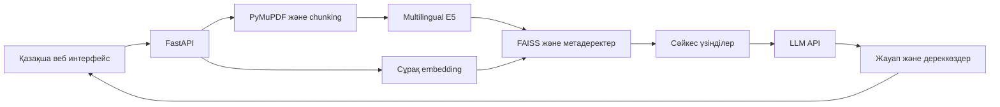

# Білім AI — оқу материалдарына сүйенген ассистент

Университет студенттеріне арналған қазақша веб-қосымша. PDF құжаттардан үзінділер іздеп, OpenAI үйлесімді API арқылы сол үзінділерге сүйенген жауап береді. Бастапқы `MVP/Index.html` беті өзгертілмеген; жаңа жүйе осы бөлек каталогта орналасқан.

Бұл — аутентификациясыз **жергілікті зерттеу прототипі**. Интернетке жалпыға ашық орналастыруға әзір емес. Құжат үзінділері сыртқы LLM провайдеріне жіберіледі; жүктеуге және жіберуге құқығыңыз бар материалдарды пайдаланыңыз.

## Мүмкіндіктер

- PDF форматын, көлемін, беттер санын, құпиясөзін және мәтін қабатын тексеру.
- Бет шекарасын сақтайтын токендік chunking және overlap.
- `intfloat/multilingual-e5-small` көптілді embedding моделі; CPU режимі.
- FAISS `IndexFlatIP`, нормаланған векторлар, top-k және ұқсастық шегі.
- SHA-256 арқылы қайталанған файлды анықтау.
- Индексті дискіде сақтау, сервер қайта қосылғанда қалпына келтіру, жою және қайта индекстеу.
- Жауаптағы `[1]` нөмірімен сәйкес құжат атауы, бет нөмірі және түпнұсқа үзінді.
- Қазақша responsive интерфейс, жүктеу күйі, жаңа диалог, түсінікті қателер.
- 20 зерттеу сұрағы, екі конфигурацияны салыстыру және CSV қорытындылау құралдары.

«Жаңа диалог» чат көрінісін ғана тазалайды. Әр сұрақ өздігінен өңделеді; бұрынғы хабарламалар LLM-ге жіберілмейді. Құжаттар барлық жергілікті диалогқа ортақ. OCR негізгі нұсқада орындалмайды: скан құжаттан мәтін табылмаса, OCR қажеттігі көрсетіледі.

## Архитектура



`app/config.py` — баптаулар; `document_processor.py` — PDF/chunking; `embedding_service.py` — embedding; `vector_store.py` — индекс; `rag.py` — тізбек; `llm_service.py` — провайдер; `main.py` — маршруттар. `data/` ішіндегі PDF, векторлар және модель кэші Git-ке кірмейді. Манифесттің атомарлық ауысуы жартылай жазылған жаңа индексті пайдалануға жол бермейді; іздеу индексі сақталған NumPy векторларынан қайта құрылады. Бір Uvicorn worker қолданыңыз: бірнеше процестің ортақ каталогқа жазуы қолдау таппайды.

## Қажетті орта

Python **3.12** осы ортада тексерілді. `requirements.lock.txt` — осы Linux CPU ортасындағы транзитивті тәуелділіктердің бекітілген тізімі; CPU torch орнатылғаннан кейін `pip install -r requirements.lock.txt` арқылы қайталауға болады. `bash scripts/install.sh` толық дайындықты орындайды; модель жүктелмесе нөлдік емес кодпен тоқтайды. Linux CPU ортасы; Windows үшін төменде PowerShell нұсқаулығы бар. GPU, Node.js және дерекқор қажет емес. Модельге шамамен 500 МБ диск және кітапханаларға қосымша орын қажет; CPU жады үшін кемінде 4 ГБ ұсынамыз. Бос ортадағы алғашқы орнату интернетті қажет етеді.

### Linux / macOS

Репозиторий түбірінен:

```bash
cd ai-education-assistant
python3 -m venv .venv
.venv/bin/python -m pip install torch==2.6.0 --index-url https://download.pytorch.org/whl/cpu
.venv/bin/python -m pip install -r requirements.txt
.venv/bin/python -m pip check
cp .env.example .env   # тек .env әлі жоқ болса
```

`.env` файлын редакторда ашып, `LLM_API_KEY` енгізіңіз. Кілтті команданың аргументіне, журналға немесе чатқа жазбаңыз. Бұлттық ортада сол атпен енгізілген айнымалы `.env` мәнінен басым болады. API кілтін frontend пайдаланбайды.

```dotenv
LLM_API_KEY=өз_кілтінізді_тек_жергілікті_файлға_енгізіңіз
LLM_BASE_URL=https://api.openai.com/v1
LLM_MODEL=gpt-4o-mini
```

Басқа провайдер үшін HTTPS мекенжайын және модель атауын ауыстырыңыз. Провайдер `/chat/completions`, `messages`, `temperature`, `max_tokens` параметрлерін және OpenAI жауап форматын қолдауы керек. Басқа формат үшін тек `LLMService` адаптерін өзгертіңіз. HTTP және автоматты redirect қолдау таппайды; TLS тексеруі қосулы.

```bash
.venv/bin/python scripts/download_model.py
.venv/bin/python -m uvicorn app.main:app --host 127.0.0.1 --port 8001
```

Жергілікті машинада браузерге `127.0.0.1:8001` енгізіңіз. Бұлттық onboarding ішінде серверге ішкі HTTP сұрауларымен тексеріс жасалады; интерфейс localhost preview жарияламайды. Серверді тоқтату: Ctrl+C. Қайта қосылғанда құжаттар сақталады.

### Windows PowerShell

```powershell
cd ai-education-assistant
py -3.12 -m venv .venv
.\.venv\Scripts\python.exe -m pip install torch==2.6.0 --index-url https://download.pytorch.org/whl/cpu
.\.venv\Scripts\python.exe -m pip install -r requirements.txt
.\.venv\Scripts\python.exe -m pip check
if (-not (Test-Path .env)) { Copy-Item .env.example .env }
notepad .env
.\.venv\Scripts\python.exe scripts\download_model.py
.\.venv\Scripts\python.exe -m uvicorn app.main:app --host 127.0.0.1 --port 8001
```

Виртуалды ортаны activation жасау міндетті емес; сол себепті PowerShell execution policy өзгертілмейді. Windows командалары құжатталды, осы Linux ортада Windows іске қосылуы тексерілмеген.

## Embedding моделі мен баптаулар

Модель: [intfloat/multilingual-e5-small](https://huggingface.co/intfloat/multilingual-e5-small). Модельдің көптілді оқытуы қазақ/орыс мәтіндерін қолдануға мүмкіндік береді; нақты қазақша жауап сапасы осы жобаның экспериментімен өлшенуі керек. Бұл қазақ тіліне мінсіз сапа кепілдігі емес.

E5 префикстері: сұраққа `query: `, құжатқа `passage: `. Нәтиже L2-нормаланады. Модельдің 512 токендік шегіне байланысты әдепкі chunk **450 токен**, overlap **90**, top-k **5**. Тапсырмада ұсынылған 500–800 токен бұл модель үшін тым үлкен болуы мүмкін; код шектен асқан chunk көлемін қабылдамайды. Шекарада жақын сөйлем соңы болса, бөлу сол жерде орындалады. Бетаралық біріктіру жоқ: бет нөмірі дәл сақталады.

| Айнымалы | Әдепкі мән | Мақсаты |
|---|---|---|
| `EMBEDDING_MODEL` | `intfloat/multilingual-e5-small` | HF модель атауы немесе жергілікті каталог |
| `EMBEDDING_REVISION` | `614241f622f53c4eeff9890bdc4f31cfecc418b3` | Әдепкі E5 үшін тексерілген commit; басқа модельде ауыстырыңыз |
| `EMBEDDING_LOCAL_ONLY` | `false` | `true` болса интернетсіз кэштен ғана оқу |
| `CHUNK_TOKENS` / `CHUNK_OVERLAP` | `450` / `90` | Токен мөлшері және қайталанатын бөлік |
| `TOP_K` / `MIN_SIMILARITY` | `5` / `0.80` | Үзінділер саны және косинустық шек |
| `MAX_UPLOAD_MB` / `MAX_PAGES` | `20` / `300` | Бір PDF шектеулері |
| `MAX_CHUNKS` / `MAX_DOCUMENTS` | `2000` / `50` | Құжат бөлігі және құжат саны |
| `DATA_DIR` | жоба ішіндегі `data` | PDF, индекс және модель кэші |
| `LLM_TIMEOUT` | `45` | Бір API сұрауын күту, секунд |

Модель/chunk параметрі өзгерсе, индекс қайта құрылуы тиіс. Шек 0.80 — бастапқы эвристика, ғылыми түрде оңтайландырылған мән емес. Ол тақырыптан тыс сұрақтардың бәрін сенімді анықтамайды. Жауаптағы сілтемені тексеру оның нөмірінің бар екенін ғана растайды; тұжырымның үзіндіден шығатынын сарапшы бағалайды.

Интернетсіз пайдалану: сенімді интернеті бар машинада модельді жүктеп, барлық модель файлдарын қорғалған жолмен көшіріңіз, `EMBEDDING_MODEL` ретінде жергілікті каталогты және `EMBEDDING_LOCAL_ONLY=true` мәнін беріңіз. Құжаттағы нұсқауларды орындататын remote code қосылмайды. Әдепкі E5 ревизиясы HF метадеректерінен тексерілген SHA-ға бекітілді; басқа модель пайдаланғанда сәйкес ревизияны таңдап, зерттеуде тіркеңіз.

## Пайдалану және API

1. `PDF жүктеу` арқылы мәтін қабаты бар құжатты таңдаңыз.
2. «Индекстелді» күйін күтіңіз. Алғашқы жүктеу модельді алатындықтан ұзақ болуы мүмкін.
3. Сұрақ қойыңыз. Жауаптағы `[1]` нөмірін төмендегі дереккөзбен салыстырыңыз.
4. Дереккөзді ашып, түпнұсқа үзінді мен бет нөмірін оқыңыз.
5. Қажет болса құжатты жойыңыз немесе индексті қайта құрыңыз.

Жауап JSON форматы: `{"ok": true, "data": ...}`; қате: `{"ok": false, "error": {"code": "...", "message": "..."}}`.

| Маршрут | Мақсаты |
|---|---|
| `GET /` | Веб-интерфейс |
| `GET /api/health` | Сервер, модель жүктелуі, кілттің болуы; құпия мәнсіз |
| `POST /api/documents/upload` | multipart өрісі `file`, PDF индекстеу |
| `GET /api/documents` | Құжаттар метадеректері |
| `DELETE /api/documents/{id}` | Құжат пен векторларын жою |
| `POST /api/chat` | `{"question":"Embedding деген не?"}` |
| `POST /api/reindex` | Индексті PDF файлдарынан қайта құру |

HTTP 413 — көлем/ресурс шегі; 415 — PDF емес; 422 — жарамсыз немесе мәтінсіз PDF; 409 — индекс қайта құру қажет; 429 — API лимиті; 502/504 — провайдер қатесі/timeout; 503 — модель немесе кілт қолжетімсіз. Контекст жоқ болса HTTP 200 және `grounded=false`; жалған жауап генерацияланбайды. `grounded=true` — үзінділер берілді және сілтемелер синтаксистік түрде расталды; бұл фактологиялық дұрыстық кепілдігі емес.

## Тесттер мен эксперимент

```bash
.venv/bin/python -m pytest -q
.venv/bin/python scripts/make_research_pdf.py
```

Windows-та `.venv/bin/python` орнына `.\.venv\Scripts\python.exe` қолданыңыз. PDF жасау Linux DejaVu Sans немесе Windows Arial қарпін пайдаланады; басқа машинада `--font /path/to/font.ttf` беріңіз.

Оқшауланған зерттеу қорын пайдаланыңыз: `.env` ішіндегі `DATA_DIR=data/experiment` деп қойып, серверді қайта қосыңыз. Жасалған **research-material.pdf** файлын ғана жүктеңіз. Модель дайын және API кілті бар кезде:

```bash
.venv/bin/python scripts/run_experiment.py
.venv/bin/python scripts/summarize_experiment.py research/runs/нақты-файл.csv
```

Эксперимент 20 сұрақ үшін ең көбі 40 API сұрауын жібереді; провайдердің ақысы мен лимиті қолданылады. Нәтиже timestamp бар жаңа файлға жазылады; бұрынғы нәтижелер өзгертілмейді. Әр жолдан кейін файл сақталады. `correctness_*`, `grounding_with_rag`, `unsupported_*` бағандарын [зерттеу әдістемесіне](research/research_report.md) сай сарапшы толтырып, тек бағаланған жолдың `status` мәнін `rated` етеді. Бағалау жүргізілмесе бағдарлама сапа статистикасын ойдан шығармайды. `research/experiment_results.csv` — **өткізілмеген эксперименттің 20 жолдық үлгісі**, нақты өлшеу емес.

Автотесттер нақты PyMuPDF пен FAISS кітапханаларын қолданады. Embedding және LLM тесттерде детерминистік алмастырғышпен немесе mock HTTP жауаптарымен оқшауланған; олардың өтуі нақты модель/API интеграциясын дәлелдемейді.

## Жиі кездесетін мәселелер

- **Модель жүктелмейді / 403:** `huggingface.co`, `cdn-lfs.huggingface.co`, `cdn-lfs-us-1.hf.co`, `cas-bridge.xethub.hf.co`, `cas-server.xethub.hf.co`, `us.aws.cdn.hf.co` қолжетімділігін және диск орнын тексеріңіз. Қажетті желі өзгерісі сақталғаннан кейін ғана жүктеуді қайталаңыз. TLS тексеруін өшірмеңіз. Әдепкі жүктеу стандартты HTTPS арқылы орындалады (`HF_HUB_DISABLE_XET=1`).
- **Кэшке жазу мүмкін емес:** `data/models` пен `data/hf-cache` каталогтарына жазу құқығы қажет; алдын ала берілген `HF_HOME` / `HF_XET_CACHE` жолдары да жазылатын болуы керек.
- **Windows-та `UnicodeDecodeError` / `cp1251`:** индекс JSON файлдары UTF-8 форматында сақталады. Жаңартылған `app/vector_store.py` оларды UTF-8 ретінде оқиды. Ескі нұсқаны уақытша іске қосу үшін PowerShell-де `$env:PYTHONUTF8 = "1"` орындап, серверді сол терминалда қайта қосыңыз. Құжаттарды немесе индексті жоюдың қажеті жоқ.
- **Кілт бапталмаған:** `LLM_API_KEY` мәнін сервер процесіне беріңіз және серверді қайта қосыңыз. Құпияны браузерге жазбаңыз.
- **API 429 шектеуі:** `insufficient_quota` / `billing_hard_limit_reached` болса провайдердегі API балансы мен квотаны тексеріңіз; жай күту жеткіліксіз болуы мүмкін. `rate_limit_exceeded` болса сұрауларды сиретіп қайталаңыз. OpenAI API төлемі ChatGPT жазылымынан бөлек. Жаңартылған `llm_service.py` осы себептерді бөлек хабарлайды; провайдер код бермесе жалпы 429 хабарламасы көрсетіледі.
- **Контекст жоқ:** мәтіні бар PDF жүктелгенін тексеріңіз, сұрақты нақтылаңыз; шекті өзгерту сапасына әсер етеді, оны бағалаңыз.
- **OCR қажет:** құжатқа сенімді жергілікті OCR құралымен мәтін қабатын қосып, қайта жүктеңіз.
- **Индекс үйлесімсіз:** жаңа модель дайын болғаннан кейін «Индексті қайта құру» батырмасын басыңыз.
- **Порт бос емес:** өз серверіңіздің күйін тексеріңіз немесе басқа `--port` қолданыңыз; бөтен процесті тоқтатпаңыз.

## Қазіргі тексеріс шекарасы

Linux Python 3.12 ортасында кітапханалар орнатылды; PDF/FAISS/API тесттері және нақты сервердегі desktop/mobile интерфейс тексерілді. Сыртқы модельдің толық жүктелуі мен ақылы LLM жауабы үшін орта рұқсаты және кілт керек. Зерттеу есебі мұны орындалған генерация тәжірибесі ретінде көрсетпейді. Нақты нәтижелер қосылғанша RAG сапасы baseline-дан жоғары деген тұжырым жасалмайды.
