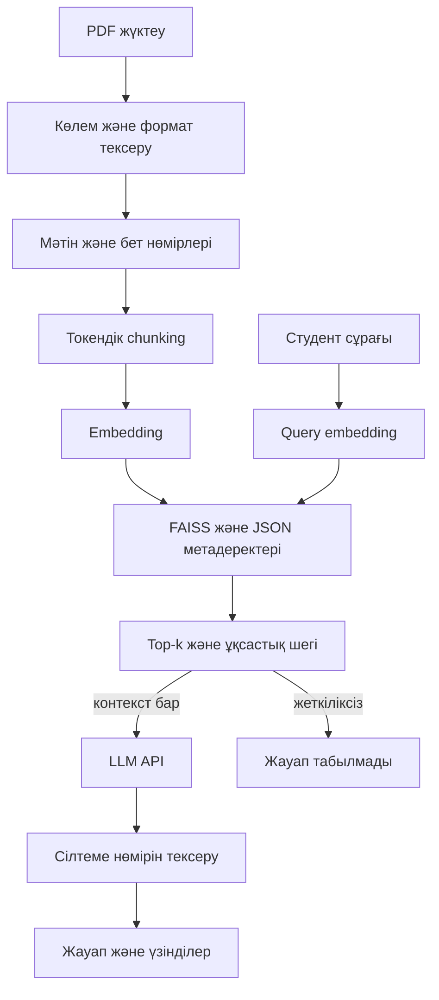

# Генеративті жасанды интеллект және RAG технологиясы негізінде білім беру процесіне арналған AI-ассистентті зерттеу және әзірлеу

## 1. Титулдық бет үлгісі

**[Университет атауы]**  
**[Факультет және кафедра]**  
Ғылыми жоба: «Генеративті жасанды интеллект және RAG технологиясы негізінде білім беру процесіне арналған AI-ассистентті зерттеу және әзірлеу»  
Орындаған: **[Студенттің аты-жөні, тобы]**  
Ғылыми жетекші: **[Аты-жөні, ғылыми дәрежесі]**  
**[Қала], 2026**

Есептің мәртебесі: бағдарламалық прототип пен эксперименттік әдістеме әзірленді; нақты LLM арқылы салыстырмалы сапа эксперименті әлі орындалмаған. Төмендегі бос нәтижелер болжаммен толтырылмаған.

## 2. Аңдатпа

Бұл жұмыста университет студенттеріне оқу құжаттары бойынша сұрақтарға қазақ тілінде жауап беретін веб-ассистент әзірленді. Жүйе PDF мәтінін шығарып, бет метадеректерін сақтайды, мәтінді токендік бөліктерге бөледі, көптілді embedding моделін қолданады және FAISS индексінде ұқсас үзінділерді іздейді. Табылған үзінділер OpenAI үйлесімді тілдік модельге контекст ретінде беріледі. Интерфейс құжат жүктеуді, индекстеу нәтижесін, чат пен дереккөз үзінділерін көрсетеді.

Зерттеу үшін төрт беттік қазақша/орысша оқу корпусы және 20 сұрақтық бақылау жиынтығы жасалды. RAG бар және жоқ режимдер бір LLM мен бірдей генерация параметрлерімен салыстырылады. Бағалау дұрыстықты, материалмен расталуын, іздеу сапасын, негізсіз фактілерді және жауап уақытын бөлек тіркейді. Бағдарламалық тесттердің нәтижесі генеративті жауаптың сапасымен теңестірілмейді. Нақты API эксперименті аяқталмағандықтан, RAG тиімділігі туралы эмпирикалық қорытынды берілмейді.

Түйін сөздер: генеративті AI, RAG, қазақша білім беру, embedding, FAISS, PDF, дереккөзге сүйенген жауап.

## 3. Мазмұны

1. Титулдық бет үлгісі; 2. Аңдатпа; 3. Мазмұны; 4. Кіріспе; 5. Өзектілік; 6. Мақсат және міндеттер; 7. Нысан мен пән; 8. Теория; 9. Әдебиеттер мен шешімдер; 10. Талаптар; 11. Архитектура; 12. Технологиялар; 13. Іске асыру; 14. RAG алгоритмі; 15. Эксперимент әдістемесі; 16. Нәтижелер; 17. Талдау; 18. Шектеулер; 19. Қорытынды; 20. Әдебиеттер; 21. Қосымшалар.

## 4. Кіріспе

Оқу процесінде студент дәріс жазбалары, электрондық оқулықтар және нұсқаулықтар сияқты әртүрлі материалмен жұмыс істейді. Ақпаратты қолмен іздеу уақыт алады, ал материалдағы терминдер әр тілде берілуі мүмкін. Генеративті модель табиғи тілдегі сұраққа түсінікті жауап бере алады, бірақ оның алдын ала үйренген білімі нақты курс мазмұнымен сәйкес келмеуі ықтимал. Мұндай жағдайда модельдің сенімді мәтін құрауы оның фактілерінің дұрыс екенін білдірмейді.

Ұсынылған жүйеде тілдік модельдің жауабы пайдаланушы жүктеген құжаттардан ізделген контекстпен шектеледі. Жауапты тексеруге құжат атауы, бет нөмірі және үзінді беріледі. Жоба программалық іске асырумен қатар, бұл тәсілдің артықшылықтары мен шектеулерін өлшейтін қайталанатын зерттеу процедурасын қамтиды.

## 5. Тақырыптың өзектілігі

Қазақша оқу ассистенті студентке қазақ тілінде сұрақ қойып, орысша материалдың мазмұнын түсінуге көмектесе алады. Бұл қажеттілік көптілді іздеу мен генерацияны бір жүйеде қарастыруды талап етеді. Жеке курстың мазмұны өзгергенде модельді қайта үйретудің орнына құжат индексін жаңарту қарапайымырақ болуы мүмкін.

RAG қолдану дереккөзге сүйенуді жеңілдетеді, бірақ сапаны автоматты түрде жақсартпайды. Қате үзінді табылуы, пайдалы контекст жоғалуы немесе модель контекстті дұрыс пайдаланбауы мүмкін. Сондықтан тақырыптың ғылыми мәні тек қосымшаны жасауда емес, іздеу мен жауап сапасын бөлек өлшеуде жатыр.

## 6. Мақсат және міндеттер

Мақсат — университет оқу материалдарына сүйенген қазақша AI-ассистент прототипін әзірлеп, RAG әсерін бақылаулы экспериментпен бағалауға дайындау.

Міндеттер: PDF өңдеу, токендік бөлу, көптілді embedding, FAISS іздеу, LLM интеграциясы, дереккөздерді көрсету, қателерді өңдеу, веб-интерфейс, автотесттер және салыстырмалы эксперимент құралдарын іске асыру. Зерттеу сұрағы: бірдей LLM қолданылғанда RAG нақты корпус сұрақтарына жауап дұрыстығын және материалмен расталуын қалай өзгертеді?

Болжам: тиісті үзінді табылған жағдайда контекст жауапты құжатқа жақындатуы мүмкін. Бұл болжам экспериментсіз нәтиже ретінде қабылданбайды.

## 7. Зерттеу нысаны мен пәні

Нысан — оқу материалдары бойынша студенттің табиғи тілде ақпарат іздеуі. Пән — көптілді семантикалық іздеу мен генеративті модельді біріктірудің жауап сапасына әсері. Зерттеу көлемі жеке жергілікті пайдаланушы, PDF мәтіні және шағын оқу корпусымен шектеледі; студент үлгеріміне ұзақмерзімді әсер бұл жұмыста өлшенбейді.

## 8. Теориялық негіздер

**Генеративті AI және LLM.** Генеративті модель үйренген үлестірім бойынша жаңа мәтін құрастырады. LLM токендер тізбегінің келесі элементін болжауға үйретіледі; тілдік дұрыстық сыртқы фактіні тексерумен тең емес. API қолдану жергілікті үлкен модельді орналастыру қажеттігін азайтады, бірақ желі мен провайдерге тәуелділік енгізеді.

**RAG.** Retrieval-Augmented Generation сыртқы қордан сұраққа қатысты ақпарат іздеуді жауап генерациясымен біріктіреді. Lewis және әріптестерінің 2020 жылғы жұмысы параметрлік білім мен іздеу қорын біріктірудің негізін сипаттайды [1]. Осы прототипте модельдің өз салмақтары өзгертілмейді: іздеу нәтижелері сұрау контекстіне енгізіледі.

**Embedding.** Мәтін векторлық кеңістікке бейнеленеді. Мағыналық жақындық косинустық ұқсастықпен салыстырылады. E5 моделінде сұраққа `query:`, үзіндіге `passage:` префиксі қажет [2]. Көптілді оқыту әр тілдегі сұрақ пен материалды салыстыруға мүмкіндік береді; нақты қазақша сапа корпусқа тәуелді.

**Chunking.** Үлкен құжатты толық енгізу контекст шегіне және шығынға әсер етеді. Chunk көлемі ақпараттың тұтастығын, ал overlap шекарадағы байланысты сақтау мүмкіндігін басқарады. Артық overlap қайталанатын контекст пен сақтау көлемін көбейтеді. Бұл нұсқада нақты tokenizer токендері қолданылады, сөз саны токен саны деп көрсетілмейді.

**Векторлық іздеу.** Нормаланған `q` және `v` векторлары үшін `q·v = cosine(q,v)`. FAISS `IndexFlatIP` барлық сақталған векторды дәл салыстырады [3]. Бұл шағын корпусқа қолайлы; ірі қор үшін approximate index пен оның recall/latency айырбасын бөлек бағалау керек.

## 9. Шешімдер мен әдебиеттерге шолу

RAG бастапқы зерттеуі білімге тәуелді NLP міндеттерінде іздеу қорын қолдануды қарастырады [1]. Multilingual E5 техникалық есебі көптілді мәтіндік embedding тәсілін сипаттайды [2]. FAISS кітапханасы сандық векторлар арасындағы ұқсастықты іздеуге арналған [3]. Sentence-BERT мағыналық сөйлем embedding ұғымын практикалық қолдануға ықпал еткен іргелі жұмыс [4].

Жалпы чат-бот студенттің құжатына байланыспауы мүмкін. Толықмәтіндік іздеу дереккөзді дәл көрсетеді, бірақ сұрақтың семантикалық қайта тұжырымдалуына шектеулі. Ұсынылған RAG жүйесі іздеу мен түсіндіруді біріктіреді. Бұл салыстыру концептуалдық; нақты өнімдерге бенчмарк жүргізілген жоқ.

E5, FAISS және Sentence Transformers еңбектерінің атауы/идентификаторы авторлардың ресми GitHub құжаттарындағы сілтемелермен тексерілді. RAG идентификаторы ParlAI ресми RAG README құжатында расталды. Толық мәтіннің әрбір тұжырымына жеке әдебиеттік аудит жүргізілген жоқ; тексерілген сілтемелер 20-бөлімде берілген.

## 10. Функционалдық және функционалдық емес талаптар

Функционалдық талаптар: PDF жүктеу, құжат тізімі, іздеу, сұраққа жауап, дереккөзді көрсету, жою, қайта индекстеу және жаңа чат көрінісі. Қате жағдайда пайдаланушы техникалық traceback орнына қазақша хабарлама алады. Құжатта жеткілікті ақпарат болмаса жауап табылмағаны көрсетіледі.

Функционалдық емес талаптар: модульдік құрылым, қайталанатын орнату, шектелген файл ресурстары, құпияны frontend-ке жібермеу, TLS тексеруі, responsive дизайн және автотесттер. Бастапқы шектер — 20 МБ, 300 бет, құжатқа 2000 chunk, 50 құжат, 3 параллель жүктеу. Бұл шектер DoS шабуылына қарсы толық қорғаныс емес; көппайдаланушылық SLA өлшенген жоқ.

## 11. Архитектура және деректер ағыны

PDF түпнұсқалары, метадеректер және векторлар `DATA_DIR` ішінде сақталады. Жаңа generation файлдары толық жазылғаннан кейін `current.json` манифесі атомарлық ауысады. Ескі generation файлдары содан кейін тазаланады. Жазу операциялары процесс ішіндегі lock арқылы реттеледі. Бұл схема бір процесс үшін жасалған; бірнеше машинаға таратылған транзакциялық сақтау ұсынылмайды.

## 12. Технологияларды таңдау негіздемесі

Python 3.12 осы Linux ортада қолжетімді әрі қолданылған кітапханалармен үйлесімді. FastAPI типтелген API мен жүктеу маршруттарын береді; Uvicorn ASGI серверін іске қосады. PyMuPDF бет метадеректерін сақтай отырып мәтін шығаруға мүмкіндік береді. Sentence Transformers E5 модель адаптерін береді; FAISS нормаланған embedding іздеуін орындайды. HTTPX провайдермен байланыс пен timeout өңдеуге, dotenv жергілікті құпия конфигурацияға, pytest тексеруге қолданылады.

Frontend фреймворк қолданылмады: HTML/CSS/JavaScript бұл шағын интерфейс үшін жеткілікті. MySQL қосылмады, өйткені аккаунттар мен үлкен тарих бастапқы талап емес. Кейін қызметтер арасындағы сақтау интерфейсін бөліп, PostgreSQL және пайдаланушыға бөлек қор қосуға болады. Нұсқалар `requirements.txt` ішінде бекітілген; `pip check` қайшылық анықтамады.

## 13. Бағдарламаны іске асыру

PDF жүктеу кезінде файлдың атауы каталог жолынан тазаланады; сақтау атауы UUID арқылы жасалады. Файл кеңейтімі және `%PDF-` сигнатурасы тексеріліп, одан кейін PDF парсері нақты құжат құрылымын ашады. Құпиясөзбен қорғалған және мәтінсіз құжатқа бөлек қате коды қайтарылады. SHA-256 қайталап келген бірдей байттарды таниды; мазмұны бірдей, бірақ қайта сақталған PDF байттары өзгерсе, ол жаңа файл ретінде қабылдануы мүмкін.

Embedding есептелгеннен кейін ғана құжат «индекстелді» деп тіркеледі. Сақтау қатесі болғанда жаңа PDF индекс бекітілмесе тазаланады. Жою құжат векторларын алып тастап, FAISS индексін қайта құрады. Модель немесе chunk параметрі өзгергенде бұрынғы индекс үйлесімсіз деп белгіленіп, сұрау жаңа векторлармен араластырылмайды.

Чаттың API жауабы сұрақты, жеке құпия мәндерді немесе HTTP провайдер денесін қате журналында жарияламайды. UI `textContent` арқылы мәтін көрсетеді: PDF пен модельдің HTML мазмұны код ретінде орындалмайды. Диалог тарихы серверде сақталмайды; сұрақтар контекстке жеке беріледі.

## 14. RAG алгоритмі

1. Сұрақ 1–2000 таңбаға тексеріліп, бос орындарынан тазартылады.
2. Индекс бос болса генерациясыз жауап табылмағаны қайтарылады.
3. Сұрақ `query:` префиксімен векторланып, нормаланады.
4. FAISS ең үлкен ішкі көбейтіндіге ие top-k үзіндіні береді.
5. Косинустық шектен төмен нәтиже алынып тасталады.
6. Қалған үзінділер `[1]`, `[2]` нөмірлері, құжат аты мен беті арқылы контекстке енгізіледі.
7. System prompt қазақша жауапты, контекстке сүйенуді және сенімсіз нұсқауларды орындамауды талап етеді.
8. API жауап, лимит, timeout және формат қатесіне тексеріледі.
9. Жауаптағы сілтеме нөмірлері бар үзінділермен сәйкестендіріледі; сілтемесіз немесе жоқ нөмірі бар жауап қабылданбайды.
10. Жауап пен сілтеме жасалған үзінділер интерфейсте көрсетіледі.

Нөмірді тексеру семантикалық entailment тексеруі емес. Келесі зерттеу кезеңінде әр тұжырымның үзіндіден шығуын адам немесе бөлек тексеруші модель бағалауы тиіс. Prompt injection-ға қарсы system prompt пен рөл бөлу қорғаныс қабаты болып табылады, бірақ абсолют кепілдік емес.

## 15. Эксперименттік әдістеме

**Корпус.** `corpus.json` — осы жоба үшін жазылған төрт беттік қазақша/орысша оқу мәтіні. Бірінші бетте RAG/embedding, екіншіде PDF/chunking, үшіншіде орысша FAISS/индекс, төртіншіде бағалау/шектеулер берілген. `make_research_pdf.py` оны мәтін қабаты бар PDF-ке айналдырады. Бұл синтетикалық шағын корпус, университеттегі оқу нәтижелерінің репрезентативтік үлгісі емес.

**Сұрақтар.** 20 сұрақ: 4 тікелей факт, 4 бірнеше үзіндіні байланыстыру, 4 термин, 4 құжатта жоқ ақпарат және 4 орысша материалға сұрақ. Сұрақтардың басым бөлігі қазақша; бір сұрақ орысша тұжырымдалып, қазақша жауап сұрайды. Құжатта жоқ ақпарат санаты бас тартуды бағалайды. Сұрақтар мен эталон беттер `test_questions.json` ішінде алдын ала бекітіледі.

**A режимі.** LLM-ге сұрақ контекстсіз беріледі. **B режимі.** Сол сұрақ ізделген контекстпен беріледі. Екі режимде модель, temperature=0 және max_tokens=1000 бірдей. System prompt-тың RAG дереккөзін қолданатын бөлігі B режимінде ғана бар; бұл эксперименттік араласудың бір бөлігі. Модельдің провайдер жағындағы жасырын жаңаруы және детерминистік емес жұмысын толық бақылау мүмкін емес. Провайдердің модель идентификаторын, embedding ревизиясын және күнін тіркеу қажет.

**Дұрыстық, 0–2.** 0: негізгі жауап қате не қажетті жауап жоқ; 1: негізгі ой ішінара дұрыс, бірақ маңызды бөлік жетіспейді; 2: эталонға сәйкес толық дұрыс. Құжатта жоқ сұрақта жеткіліксіз ақпаратты дұрыс мойындау — 2; ойдан нақты жауап беру — 0.

**Дереккөзге сәйкестік, 0–2.** 0: негізгі нақты тұжырымдар материалда расталмайды; 1: ішінара расталады; 2: барлық негізгі нақты тұжырымдар көрсетілген материалда бар. Ақпарат жоқ сұрақтың дұрыс бас тартуы — 2. Нөмірдің болуы өздігінен 2 балл бермейді.

**Негізсіз факт, 0/1.** Кемінде бір маңызды нақты факт материалмен расталмаса — 1; болмаса — 0. Бұл өлшем жалпы әлемдегі ақиқат пен корпуспен расталуды ажыратады. Baseline дұрыс әлемдік факт келтірсе де, ол корпуспен расталмаса осы corpus-grounding өлшемінде негізсіз деп белгіленеді.

**Іздеу.** Hit@k — эталон беттердің кемінде бірі табылғаны; page recall — табылған эталон беттер үлесі. Бұл бет деңгейіндегі өлшем; дәл қажетті абзац табылғанын толық кепілдендірмейді. Ақпарат жоқ сұраққа retrieval_hit/recall бос қалдырылады, ал генерацияның дұрыс бас тартуы бөлек бағаланады.

**Уақыт.** Baseline API уақыты, retrieval уақыты және retrieval+RAG API уақыты `perf_counter` көмегімен өлшенеді. Модель эксперимент алдында жүктеледі; алғашқы жүктеу latency көрсеткішіне кірмейді. 20 сұрақтың бір өтуі сенімділік интервалы үшін жеткіліксіз; қайталанатын эксперимент пен екі сарапшы арасындағы келісімді кейін қосу ұсынылады.

**Процедура.** Бөлек DATA_DIR дайындау → тек research-material.pdf индекстеу → API экспериментін жүргізу → жауаптарды режим аттарын жасырып екі сарапшыға бағалату → `rated` күйін белгілеу → CSV қорытындылау. Осы іске асыру бағалау бағандарын автоматты толтырмайды. 350/70, 450/90 chunk параметрлері және top-k 3/5 үшін бөлек файлдарға тәжірибе жасауға болады; бұл қосымша тәжірибелер әлі жүргізілмеген.

## 16. Тестілеу нәтижелері және салыстырмалы кестелер

2026-10-14 күнгі Linux ортада:

| Тексеріс | Нәтиже | Нені растайды |
|---|---|---|
| Python тәуелділіктері және pip check | Орнатылды, қайшылық жоқ | Нұсқалардың орнату үйлесімділігі |
| PyMuPDF/FAISS/API/LLM mock автотесттері | 41 тест өтті | Формат, chunking, индекс сақтау/жою, API қателері |
| Нақты FastAPI health және веб-бет | Өтті | Сервер мен статикалық интерфейс |
| Chromium desktop/mobile тексерісі | Өтті | Чаттың бос контекст күйі, жаңа диалог, PDF қатесі, responsive дизайн |
| Нақты E5 семантикалық сапасы | Бөлек тексеріс қажет | Автотест алмастырғыштары мұны растамайды |
| Нақты LLM генерациясы | Орындалмады: API кілті жоқ | Провайдермен нақты жауап алынған жоқ |
| RAG бар/жоқ 20 сұрақтық салыстыру | Орындалмады | CSV ішінде status=not_run |

| Сапа өлшемі | RAG жоқ | RAG бар |
|---|---|---|
| Орташа дұрыстық, 0–2 | Өлшенбеген | Өлшенбеген |
| Орташа дереккөз сәйкестігі, 0–2 | Бұл режимде сілтеме талап етілмейді | Өлшенбеген |
| Негізсіз фактілі жауаптар үлесі | Өлшенбеген | Өлшенбеген |
| Орташа жауап уақыты | Өлшенбеген | Өлшенбеген |
| Hit@k / page recall | Іздеу жоқ | Өлшенбеген |

`experiment_results.csv` — 20 жоспарланған жолдық шаблон. Нақты run файлдары `research/runs/` ішінде бөлек сақталады. Сандар жоқ жерде нәтижені нөлге тең деп түсіндіруге болмайды.

## 17. Нәтижелерді талдау

Автотесттер прототип модульдерінің күтілген басқару ағынын растайды: қайталанған жүктеу жаңа индекс қоспайды, жойылған PDF векторлары қайтып келмейді, бос контекст кезінде LLM шақырылмайды, провайдердің қате мәтіні пайдаланушыға жарияланбайды. Browser тексерісі интерфейстің нақты сервермен жұмыс істеуін көрсетеді.

Бұл тексерістер embedding кеңістігіндегі қазақша мағыналық сапаны немесе LLM-нің фактілік дұрыстығын өлшемейді. Сондықтан RAG baseline-нан жақсы деген нәтиже шығаруға жеткіліксіз. Эксперимент аяқталғанда қате жауаптарды іздеу қатесі, chunk шекарасы қатесі, жеткіліксіз контекст және контекстті қолдану қатесі бойынша топтау қажет. Орташа көрсеткішпен бірге барлық санаттың нәтижесін беру керек; аз сұрақтан алынған айырманы жалпылауға болмайды.

## 18. Шектеулер және қауіпсіздік

- Нақты LLM жұмысына сервердегі API кілті, провайдердің қолжетімділігі және ақысы қажет.
- Модельдің салмақтарын алғашқы рет жүктеу желі домендері мен кэшке жазу құқығына тәуелді.
- OCR орындалмайды; кестелер, формулалар, бағандық макет және аралас мәтіннің шығуы қате болуы мүмкін.
- Бетаралық біріктіру жоқ; бірнеше бетке созылған аргументтің байланысы retrieval нәтижесіне тәуелді.
- Ұқсастық шегі мен top-k эмпирикалық оңтайландырылмаған. Тақырыптан тыс сұраққа байланысты үзінді табылса, модельдің дұрыс бас тартуы маңызды.
- Prompt нұсқаулығы зиянды құжат мазмұнын толық бейтараптандырмайды. Жүйеде құрал орындау мен құпияны frontend-ке беру жоқ, бірақ жауап мәтініне әсер ету қаупі қалады.
- PDF пен метадеректер жергілікті дискіде шифрланбайды. Файлдарға қолжетімділікті орта иесі бақылайды.
- Аутентификация, пайдаланушы қорларының оқшаулануы, rate limiting, өндірістік аудит пен резервтік көшіру жоқ.
- Бір процесс және шағын corpus мақсат етілген. Көпworker жазуы, үлкен жүктеме мен ұзақ мерзімді педагогикалық тиімділік тексерілмеген.

## 19. Қорытынды

Қазақша интерфейсі, PDF өңдеу тізбегі, embedding адаптері, FAISS сақтау/іздеу модулі және OpenAI үйлесімді LLM интеграциясы бар модульдік прототип әзірленді. Автотесттер мен browser тексерісі бірқатар бағдарламалық мүмкіндіктерді растады. Ғылыми бөлікте салыстырмалы эксперименттің корпусы, 20 сұрағы, эталондары және бағалау ережелері дайындалды.

API кілтімен нақты эксперимент жүргізілмегендіктен генеративті жауап сапасының жақсаруы туралы қорытынды жасалмайды. Келесі қадам — нақты модель/API қолжетімділігін тексеріп, белгіленген әдістемемен жауаптарды жинау және тәуелсіз бағалау. Прототипті өндірістік жүйеге айналдыру үшін қолжетімділік басқаруы мен сақтау оқшаулануын бөлек әзірлеу қажет.

## 20. Пайдаланылған әдебиеттер

1. Lewis, P. және әріптестері. **Retrieval-Augmented Generation for Knowledge-Intensive NLP Tasks**. NeurIPS, 2020. arXiv:2005.11401. https://arxiv.org/abs/2005.11401. Идентификаторды растайтын ресми код құжаты: https://github.com/facebookresearch/ParlAI/blob/main/parlai/agents/rag/README.md.
2. Wang, L.; Yang, N.; Huang, X.; Yang, L.; Majumder, R.; Wei, F. **Multilingual E5 Text Embeddings: A Technical Report**. 2024. arXiv:2402.05672. https://arxiv.org/abs/2402.05672. Авторлар/жыл ресми библиографиядан тексерілді: https://github.com/microsoft/unilm/blob/master/e5/README.md.
3. Douze, M. және әріптестері. **The Faiss library**. 2024. arXiv:2401.08281. https://arxiv.org/abs/2401.08281. Ресми библиография: https://github.com/facebookresearch/faiss/blob/main/README.md.
4. Reimers, N.; Gurevych, I. **Sentence-BERT: Sentence Embeddings using Siamese BERT-Networks**. EMNLP-IJCNLP, 2019. arXiv:1908.10084. https://arxiv.org/abs/1908.10084. Ресми библиография: https://github.com/UKPLab/sentence-transformers/blob/master/README.md. 2019 еңбегі embedding теориясының іргелі негізі ретінде енгізілді.
5. Reimers, N.; Gurevych, I. **Making Monolingual Sentence Embeddings Multilingual using Knowledge Distillation**. EMNLP, 2020. arXiv:2004.09813. https://arxiv.org/abs/2004.09813. Сол ресми Sentence Transformers библиографиясында тексерілді.
6. FastAPI ресми құжаттамасы: https://fastapi.tiangolo.com/.
7. PyMuPDF ресми құжаттамасы: https://pymupdf.readthedocs.io/.
8. Sentence Transformers ресми құжаттамасы: https://www.sbert.net/.
9. OpenAI Chat Completions API ресми анықтамасы: https://platform.openai.com/docs/api-reference/chat.

Ғылыми мақалалардың arXiv идентификаторлары берілді; тексерілмеген DOI енгізілген жоқ. Ресми GitHub библиографиялары 2026-10-14 күні HTTPS арқылы оқылды. Техникалық құжаттама сілтемелері анықтамалық ретінде берілген; бәрінің толық онлайн мазмұны жеке тексерілген деп мәлімделмейді.

## 21. Қосымшалар

**А — код.** `app/rag.py`, `embedding_service.py`, `vector_store.py` және `llm_service.py` — толық орындалатын іске асыру. Іске қосу командалары README ішінде. Бос интеграция орнына API қолжетімсіздігі анық қатемен өңделеді.

**Ә — тест сұрақтары.** `tests/test_questions.json` — санат, эталон жауап, эталон бет және 20 сұрақ. `research/corpus.json` — сол сұрақтарға арналған оқу мәтіні.

**Б — нәтижелер.** `research/experiment_results.csv` — жоспарланған эксперимент үлгісі. `scripts/run_experiment.py` нақты жауаптарды жаңа run файлына жазады; `summarize_experiment.py` тек бағаланған жолдарды есептейді.

**В — демонстрация.** `screenshots/desktop.png` және `screenshots/mobile.png` — нақты интерфейс көріністері. Контекст жоқ сұрақ және кілт жоқ күйі демонстрацияланады; олар генеративті модельдің нақты жауабы ретінде көрсетілмейді.
